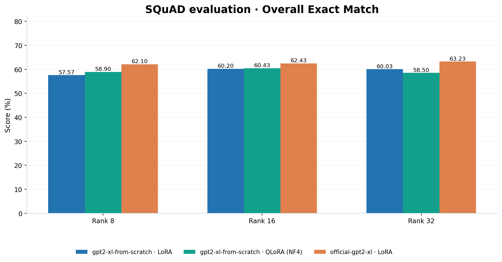
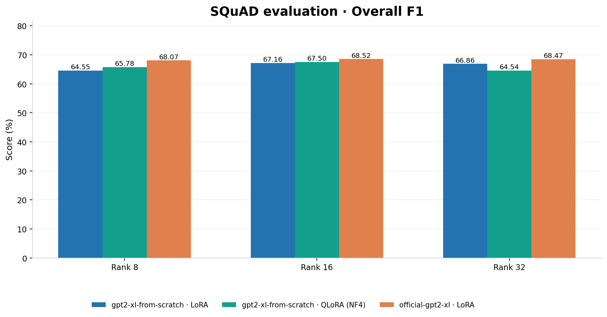
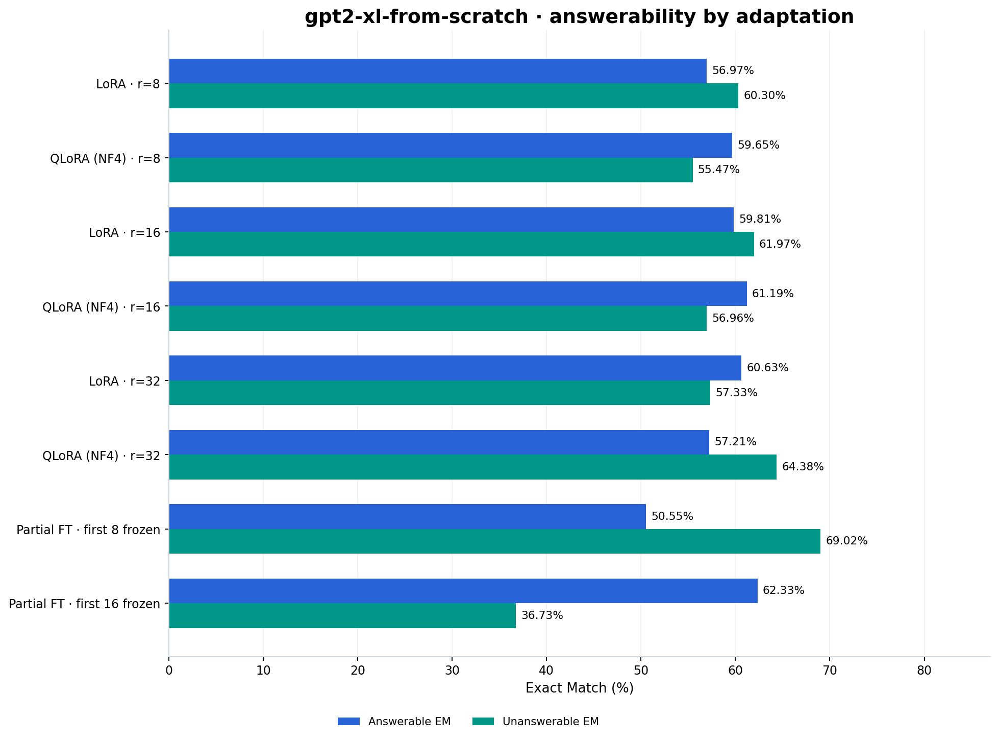
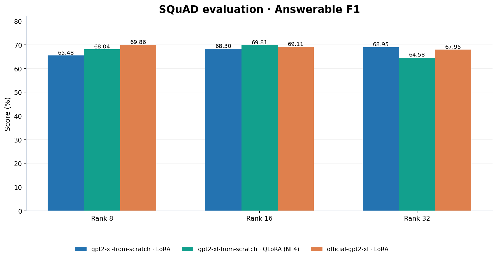
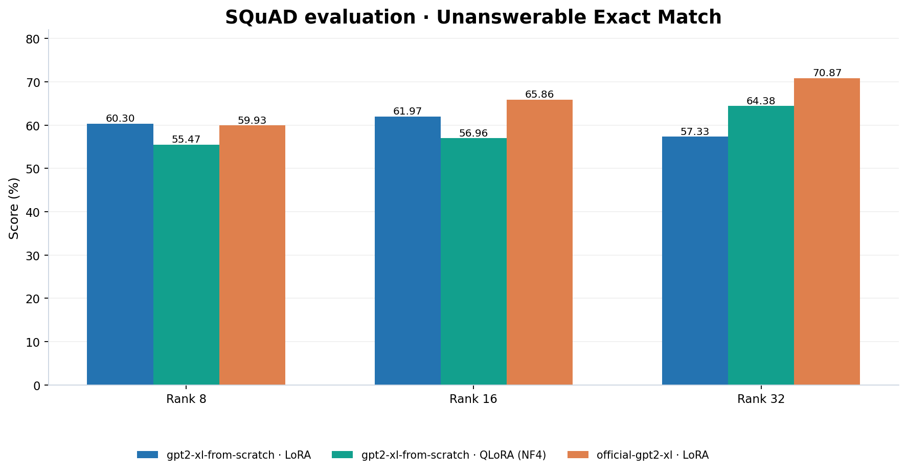
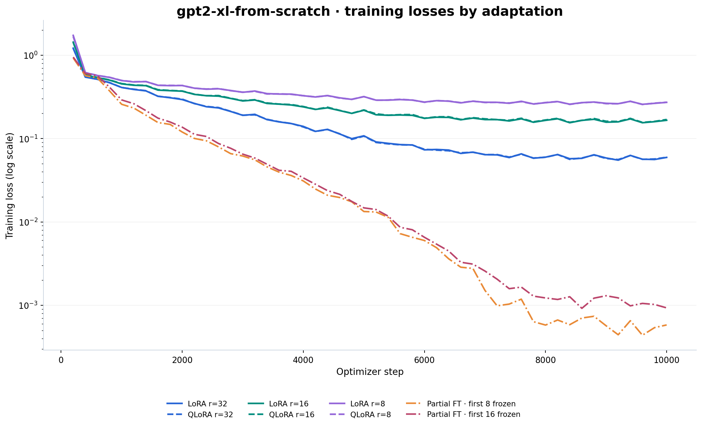
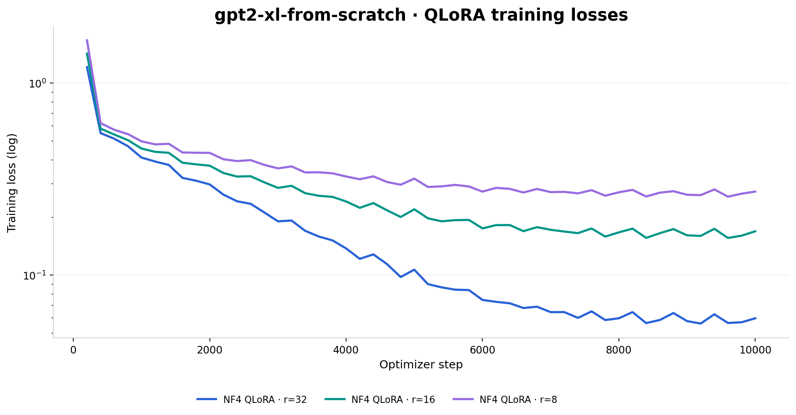
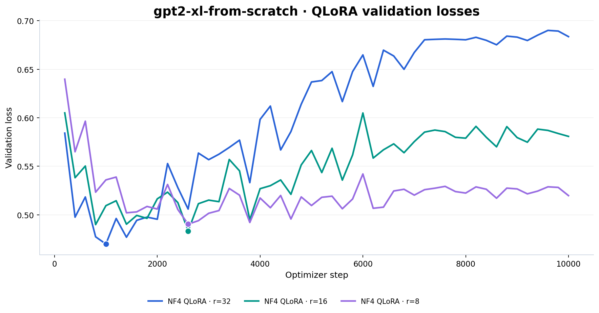
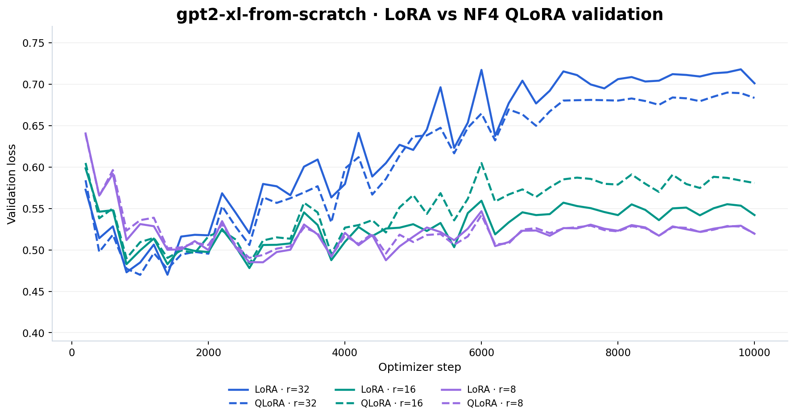

# Implementing LoRA, QLoRA, and Autoregressive Inference from Scratch: Benchmarking a Custom GPT-2 XL on SQuAD 2.0

**Custom CMHA adapters • NF4 quantization integration • distributed fine-tuning • autoregressive question answering • matched-model benchmarking**

This README documents the **fine-tuning and autoregressive inference work within GPT LLM Forge**. The foundation model, **`gpt2-xl-from-scratch`**, is implemented and pretrained separately in the repository's **`gpt/` folder**. That folder contains the GPT architecture and its pretraining code; this README picks up at the **pretrained checkpoint** and focuses on adapting, evaluating, and benchmarking it.

I implemented **LoRA directly inside my custom Causal Multi-Head Attention (CMHA)** module—not through a PEFT wrapper—with independent, trainable low-rank updates for the Q, K, and V projections and a custom adapter-merging path. I extended this implementation into **QLoRA**, integrating bitsandbytes NF4 quantization for the frozen backbone while keeping the LoRA factors trainable. I also implemented the SQuAD fine-tuning workflow and **autoregressive question-answering inference**, then benchmarked the results against **`official-gpt2-xl`**.

The evaluation uses **3,000 questions from unseen, held-out SQuAD 2.0 shards** with greedy generation and Exact Match/F1 scoring.

> **Implementation boundary:** The LoRA parameterization, CMHA integration, QLoRA conversion pathway, QA training/inference, and evaluation are implemented in this project. **bitsandbytes supplies the NF4 quantization layers and 8-bit optimizer**, rather than custom quantization kernels. The `official-gpt2-xl` LoRA baseline uses Hugging Face/PEFT. The base GPT model and its original pretraining are documented in **`gpt/`**, not repeated here.

## Project at a glance

| Component | What I implemented or integrated |
|:--|:--|
| **Foundation checkpoint** | Use `gpt2-xl-from-scratch` from the repository’s `gpt/` folder as the pretrained starting point for this work. |
| **LoRA inside CMHA** | Independent `Aq/Bq`, `Ak/Bk`, `Av/Bv` low-rank factors, frozen base projections, scaled Q/K/V updates, and `apply_lora()` merging for conventional LoRA. |
| **QLoRA pathway** | Recursive backbone layer replacement with bitsandbytes NF4 `Linear4bit`, FP16 compute, floating-point trainable adapters, and 8-bit optimizer state. |
| **Supervised QA** | Packed examples, per-example block-causal attention masks, and answer-only cross-entropy. |
| **Autoregressive inference** | Prompt/answer generation loop, greedy decoding, end-of-text termination, sliding context, checkpoint restoration, and EM/F1 evaluation. |
| **Benchmarking** | LoRA r=8/16/32, QLoRA r=8/16/32, partial fine-tuning, and rank-matched LoRA on `official-gpt2-xl`. |

### Headline results

| Model and adaptation | Rank | Exact Match | Token F1 |
|:--|--:|--:|--:|
| `gpt2-xl-from-scratch` · LoRA | 16 | 60.20% | 67.16% |
| **`gpt2-xl-from-scratch` · NF4 QLoRA** | **16** | **60.43%** | **67.50%** |
| `official-gpt2-xl` · LoRA | 16 | 62.43% | 68.52% |

**The custom QLoRA implementation preserved essentially the same downstream QA performance as standard LoRA at the best-performing rank.** Its F1 was just **1.03 percentage points** below the rank-16 official GPT-2 XL LoRA baseline. These are individual-run results, not proof that NF4 always improves accuracy.

## Contents

- [Starting point and QA task](#starting-point-and-qa-task)
- [Implementing LoRA inside CMHA](#implementing-lora-inside-cmha)
- [Implementing the QLoRA pathway](#implementing-the-qlora-pathway)
- [Building the autoregressive QA pipeline](#building-the-autoregressive-qa-pipeline)
- [Experimental setup](#experimental-setup)
- [Benchmark results](#benchmark-results)
- [Training dynamics and checkpoint selection](#training-dynamics-and-checkpoint-selection)
- [Checkpoints and reproduction](#checkpoints-and-reproduction)

## Starting point and QA task

### Pretrained model from `gpt/`

The starting point for all custom-model experiments here is the **`gpt2-xl-from-scratch` pretrained checkpoint**, produced using the architecture and language-model training implementation in the **`gpt/` folder** of GPT LLM Forge. For the original GPT implementation, pretraining setup, and foundation-model training workflow, see that folder. The sections below cover **what happens after pretraining**: building LoRA and QLoRA adapters, supervised QA training, autoregressive inference, and comparisons with `official-gpt2-xl`.

### SQuAD prompt representation

Each training example is serialized as:

```text
Context: <passage>
Question: <question>
Answer: <reference answer><|endoftext|>
```

Unanswerable SQuAD 2.0 questions are retained during preprocessing. If `answers['text']` is empty, the serializer emits an empty answer field:

```text
Context: <passage>
Question: <question with no supported answer>
Answer: <|endoftext|>
```

In the actual preprocessing code the answer begins after `"Answer: "`, so an empty answer may include a leading space token. The scoring code removes the end-of-text token and normalizes whitespace, ensuring that this is treated as an empty reference.

### Answer-only supervision and packed attention

The supervised objective trains the model to **predict answer tokens**, including the terminating end-of-text token. Context and question tokens provide conditioning information but are ignored by the supervised cross-entropy loss:

In words, the QA training loss is the **average negative log-likelihood over only the answer and end-of-text target positions**.

- Let `A` be the set of supervised answer/EOT target positions.
- For each target position `t` in `A`, the model predicts token `x_t` conditioned on all previous visible tokens `x_<t`.
- The loss is the average of `-log p_theta(x_t | x_<t)` over all positions in `A`.
- All positions outside `A` are ignored with `ignore_index = -1`.


Because individual QA examples are packed together in fixed-length token windows, the dataloader also constructs a **block-causal attention mask**. A query can attend only to earlier positions **within the same `Context:` block**. This prevents one packed QA example from reading tokens from an unrelated example in the same training sequence. The implementation excludes incomplete terminal blocks from the supervised mask.

This differs from the usual unmodified causal mask: **autoregressive order is preserved, but cross-example attention is disallowed** during packed training.

## Implementing LoRA inside CMHA

### Independent low-rank updates for Q, K, and V

I implemented the low-rank adapter pathway directly in my **custom Causal Multi-Head Attention (CMHA)** module. Each attention block has six trainable matrices: `Aq`, `Bq`, `Ak`, `Bk`, `Av`, and `Bv`. The pretrained Q/K/V projections are frozen for LoRA training; only these low-rank factors are updated.

For a base projection matrix `W` of shape `(d_out, d_in)`, an adapter factor `A` has shape `(r, d_in)` and `B` has shape `(d_out, r)`. Their product has the same shape as `W`, so the update can be inserted directly into the projection computation:

```text
ΔWq = α (Bq @ Aq)
ΔWk = α (Bk @ Ak)
ΔWv = α (Bv @ Av)

Wq_effective = Wq + ΔWq
Wk_effective = Wk + ΔWk
Wv_effective = Wv + ΔWv
```

The important feature is a learned, scaled low-rank correction rather than full-matrix updates. The rank `r` controls the adapter's capacity and the number of trainable parameters.

### Training, merging, and saving adapters

During fine-tuning, the CMHA attention computation includes the adapter contributions and backpropagates through the A/B factors while the base projections stay frozen. For conventional full-precision LoRA inference, I implemented **`apply_lora()`** to merge the learned updates into Q/K/V weights. After merging, the forward pass can use the effective projection matrices directly, without an extra low-rank branch per generated token.

The adapter checkpoints `lora_weights_8.pt`, `lora_weights_16.pt`, and `lora_weights_32.pt` store the learned low-rank weights for their respective runs. This attention-level LoRA design is **not a PEFT wrapper** on the custom model: the parameterization and projection integration live in the custom implementation.

## Implementing the QLoRA pathway

### Quantize the frozen backbone, retain custom adapters

I extended the same CMHA LoRA implementation with **4-bit NF4 quantization of the frozen backbone**. A recursive utility identifies frozen `nn.Linear` projections and replaces them with `bnb.nn.Linear4bit` modules, copying the pretrained weights before CUDA quantization. The tested 48-layer model converts **288 linear layers** in total.

```python
# Simplified structure of the custom conversion path
new_layer = bnb.nn.Linear4bit(
    old_layer.in_features,
    old_layer.out_features,
    bias=old_layer.bias is not None,
    compute_dtype=torch.float16,
    quant_type="nf4",
    compress_statistics=True,
)
new_layer.load_state_dict(old_layer.state_dict())
new_layer.requires_grad_(False)
```

The **bitsandbytes library implements the quantized storage and operations**; the model-specific layer selection, conversion order, CMHA adapters, and trainer integration are part of this project. The Q/K/V low-rank factors remain in floating-point precision and are trained on top of the frozen NF4 backbone. The DDP training configuration uses `bnb.optim.AdamW8bit` for optimizer-state storage.

### Model construction and distributed execution

The QLoRA training pathway follows this conceptual sequence:

```text
Initialize custom GPT with attention-level A/B adapters
    → load pretrained backbone checkpoint
    → convert frozen Linear projections to NF4 Linear4bit
    → move model to CUDA to initialize quantization
    → wrap in DDP and build optimizer for trainable adapters
    → train / validate / save adapter checkpoints
```

Quantization must occur **before wrapping the model in DDP**, because replacing modules after DDP construction would invalidate the module/parameter references it registered. The backbone is loaded consistently across ranks before quantization.

### QLoRA checkpoint and inference semantics

The saved `qlora_weights_8.pt`, `qlora_weights_16.pt`, and `qlora_weights_32.pt` checkpoints contain **floating-point low-rank adapter weights**, not a complete NF4-quantized model. Testing reconstructs the base weights and the compatible quantization configuration, then applies the trained adapter according to the evaluation pathway.

There is an important implementation distinction: conventional LoRA can merge the update into full-precision `W`, but **merging first and then quantizing (`Q(W - αBA)`) is not numerically identical to using a quantized backbone with a separate update (`Q(W) - αBA`)**. The exact inference path should therefore be kept consistent with the QLoRA training setup. The results here are the observed outputs of the project's QLoRA evaluation checkpoints.

## Building the autoregressive QA pipeline

### Prompt-conditioned generation

Inference is implemented as a **next-token decoding loop**, not a call to an instruction-tuned hosted model. Given a context and question, the evaluator builds a prompt ending at `Answer:` and repeatedly passes the current token context to the custom GPT. At each step it takes the highest-logit token (`argmax`) and appends it to the sequence.

```text
Prompt tokens → GPT logits for next token → argmax
              → append predicted token → repeat
              → stop at <|endoftext|> or generation limit
```

The generation loop enforces the 1,024-token context window by keeping the most recent tokens when a sequence grows beyond the limit. The reported experiments use up to **150 generated tokens**, terminate early at `<|endoftext|>`, and then decode the generated token IDs into answer text.

The evaluator supports full partial-FT checkpoints, pretrained backbone plus LoRA adapters, and the corresponding QLoRA adapter/checkpoint restoration pathway. Conventional LoRA uses `apply_lora()` when merging is appropriate; the NF4 pathway must respect the separate quantized-backbone/adapter behavior discussed above.

### Exact Match, F1, and answerability

For each checkpoint, evaluation runs on one GPU with the same procedure:

1. Instantiate the appropriate GPT architecture, then restore the full partial-FT checkpoint or the original pretrained backbone plus the selected LoRA/QLoRA adapter weights. For QLoRA, reproduce the quantization and adapter-application steps used by its evaluation implementation.
2. Feed the prompt ending in `Answer:`; do **not** include ground truth in the input.
3. Decode greedily (`argmax`) until `<|endoftext|>` or the configured token limit (150 new tokens by default). Generation uses a sliding context bounded by 1,024 tokens.
4. Remove EOT from both prediction and reference; normalize by lowercasing, removing punctuation and `a/an/the`, then collapsing whitespace.
5. Calculate normalized **Exact Match (EM)** and word/token-overlap **F1**, both in aggregate and separately for answerable and unanswerable examples.

For nonempty references, F1 is the harmonic mean of unigram-token precision and recall. If either normalized prediction or reference is empty, F1 is **1 only if both are empty**; otherwise it is **0**.

All checkpoints were evaluated on the same **3,000 examples**; the evaluation output reports **0 prompts initially longer than the context window**.

## Experimental setup

### Models and adaptation methods

The pretrained `gpt2-xl-from-scratch` checkpoint from `gpt/` was evaluated after **standard LoRA (r=8/16/32)**, **NF4 QLoRA (r=8/16/32)**, and **partial conventional fine-tuning**. The reference model is the pretrained GPT-2 XL checkpoint (`official-gpt2-xl`), adapted with PEFT LoRA at the same three nominal ranks.

The architectures share a 48-block, 1,600-wide, 25-head macro-configuration and GPT-2 BPE, but have different pretraining histories. `official-gpt2-xl` uses a 50,257-token vocabulary; the custom model pads its vocabulary to 50,304. `official-gpt2-xl` uses LoRA on the fused `c_attn` QKV projection while the custom CMHA uses independent Q/K/V factors, so **the same nominal rank does not guarantee the same adapter parameter count**.

### Unseen-shard evaluation

SQuAD 2.0 context/question/answer records are serialized into GPT-2 BPE token sequences ending with `<|endoftext|>`, then packed into fixed-length token shards. **Distinct, unseen shards are reserved for evaluation** and are not used in supervised fine-tuning updates. The evaluation reconstructs context/question prompts and reference answers from those shards.

All reported models are evaluated on the same **3,000 questions** under a shared prompt and decoding procedure. This is a project-internal shard-based comparison; the scores should not be confused with official SQuAD benchmark submissions.

Both models use the project's packed QA dataloader, answer-only loss, comparable prompting and decoding, and the same **3,000 unseen-shard evaluation questions**. The comparison is a controlled downstream engineering benchmark rather than a claim of identical foundation-model pretraining or architecture internals.

### Partial fine-tuning as another baseline

With `lora_rank = 0`, the original pretrained weights are updated in the unfrozen part of the network. The `n_frozen_layers` argument freezes the **first N Transformer blocks**, not the last N. This follows the trainer's implementation, which applies `requires_grad = False` to `transformer.layers[:n_frozen_layers]`.

| Training configuration | Frozen Transformer blocks | Trainable Transformer blocks |
|:--|:--|:--|
| `--lora_rank 0 --n_frozen_layers 8 --iter_batch_size 1` | First 8 | Remaining 40 |
| `--lora_rank 0 --n_frozen_layers 16 --iter_batch_size 1` | First 16 | Remaining 32 |

Parameters outside these blocks may remain trainable depending on their `requires_grad` settings. This is a partial-weight-update comparison against LoRA, not a parameter-matched experiment. In contrast to LoRA's Q/K/V-only updates, these configurations can update the unfrozen Transformer blocks' full attention and feed-forward weights.

## Benchmark results

### Three-way comparison: LoRA, QLoRA, and official GPT-2 XL

This is the main end-to-end check: does independently implemented LoRA or QLoRA on `gpt2-xl-from-scratch` retain downstream answer-generation performance close to `official-gpt2-xl`?





| Rank | Model | Adaptation | Overall EM | Overall F1 | Answerable EM | Answerable F1 | Unanswerable EM |
|:--:|:--|:--|--:|--:|--:|--:|--:|
| 8 | `gpt2-xl-from-scratch` | LoRA | 57.57% | 64.55% | 56.97% | 65.48% | 60.30% |
| 8 | `gpt2-xl-from-scratch` | **NF4 QLoRA** | 58.90% | 65.78% | 59.65% | 68.04% | 55.47% |
| 8 | `official-gpt2-xl` | LoRA | **62.10%** | **68.07%** | 62.58% | 69.86% | 59.93% |
| 16 | `gpt2-xl-from-scratch` | LoRA | 60.20% | 67.16% | 59.81% | 68.30% | 61.97% |
| 16 | `gpt2-xl-from-scratch` | **NF4 QLoRA** | **60.43%** | **67.50%** | 61.19% | **69.81%** | 56.96% |
| 16 | `official-gpt2-xl` | LoRA | 62.43% | **68.52%** | 61.68% | 69.11% | 65.86% |
| 32 | `gpt2-xl-from-scratch` | LoRA | 60.03% | 66.86% | 60.63% | **68.95%** | 57.33% |
| 32 | `gpt2-xl-from-scratch` | **NF4 QLoRA** | 58.50% | 64.54% | 57.21% | 64.58% | 64.38% |
| 32 | `official-gpt2-xl` | LoRA | **63.23%** | **68.47%** | **61.56%** | 67.95% | **70.87%** |

**Rank 16 is the strongest NF4 QLoRA run:** its **60.43% EM and 67.50% F1** slightly exceed the corresponding FP16-backbone LoRA run (**60.20% / 67.16%**). The difference is **+0.23 EM points and +0.34 F1 points**. Relative to `official-gpt2-xl` LoRA rank 16, QLoRA is **2.00 EM points and 1.03 F1 points lower**. On answerable questions alone, it scores **69.81% F1**, versus **69.11%** for the official reference at rank 16.

At rank 8, QLoRA improves on the scratch-model LoRA checkpoint by **+1.33 EM and +1.23 F1 points**. At rank 32, however, QLoRA scores **1.53 EM and 2.32 F1 points lower** than the scratch-model LoRA run. The effect of NF4 quantization is therefore **rank-dependent in these experiments**, not a consistent increase or decrease in final QA scores.

### All `gpt2-xl-from-scratch` adaptation methods

The following plots include **all eight `gpt2-xl-from-scratch` fine-tuning configurations**: LoRA ranks 8/16/32, NF4 QLoRA ranks 8/16/32, and partial fine-tuning with the first 8 or 16 layers frozen.


| Fine-tuning method | Overall EM | Overall F1 | Answerable EM | Answerable F1 | Unanswerable EM / F1 |
|:--|--:|--:|--:|--:|--:|
| LoRA · rank 8 | 57.57% | 64.55% | 56.97% | 65.48% | 60.30% |
| QLoRA (NF4) · rank 8 | 58.90% | 65.78% | 59.65% | 68.04% | 55.47% |
| LoRA · rank 16 | 60.20% | 67.16% | 59.81% | 68.30% | 61.97% |
| **QLoRA (NF4) · rank 16** | **60.43%** | **67.50%** | 61.19% | 69.81% | 56.96% |
| LoRA · rank 32 | 60.03% | 66.86% | 60.63% | 68.95% | 57.33% |
| QLoRA (NF4) · rank 32 | 58.50% | 64.54% | 57.21% | 64.58% | 64.38% |
| Partial FT · first 8 frozen | 53.87% | 59.62% | 50.55% | 57.56% | **69.02%** |
| Partial FT · first 16 frozen | 57.73% | 64.87% | **62.33%** | **71.04%** | 36.73% |

**Evaluation:** Every configuration was scored on the same 3,000 questions from unseen, held-out evaluation shards. Across these eight configurations, QLoRA rank 16 has the highest overall EM and F1, while partial FT with the first 16 blocks frozen leads on answerable F1.

### Answerability and score trade-offs



The best answerable F1 comes from **partial FT with the first 16 layers frozen (71.04%)**, followed by **QLoRA rank 16 (69.81%)** among the QLoRA runs. For unanswerable questions, **partial FT with the first 8 layers frozen (69.02%)** performs best among these eight configurations, followed by **QLoRA rank 32 (64.38%)**.

An empty reference receives EM = F1 = 1 only for an empty normalized prediction; otherwise both scores are zero. Thus, reported unanswerable EM and F1 are equal.





For rank 16, QLoRA raises `gpt2-xl-from-scratch` answerable F1 from **68.30%** to **69.81%**, while its correct empty-response rate changes from **61.97%** to **56.96%**. At rank 32, the pattern reverses: QLoRA has **64.38% unanswerable EM**, compared with **57.33%** for LoRA, while answerable F1 decreases from **68.95%** to **64.58%**. These task-specific changes explain why aggregate scores alone do not describe the full effect of backbone quantization.

Compared with standard LoRA at **rank 16**, NF4 QLoRA increases overall EM by **0.23 percentage points** and overall F1 by **0.34 points**. It also increases answerable F1 by **1.51 points** (68.30% → 69.81%), while unanswerable EM decreases by **5.01 points** (61.97% → 56.96%). The higher overall scores therefore do not indicate an improvement on every QA category.

At rank 8, QLoRA improves overall EM and F1 over LoRA; at rank 32, standard LoRA performs better overall. These are single-run comparisons rather than evidence that quantization is always better or worse.

### Matched-rank reference plots

The following views isolate the matched-rank comparison with the original pretrained model; the official baseline uses LoRA, not QLoRA.

These comparisons place both `gpt2-xl-from-scratch` adaptation methods alongside **`official-gpt2-xl` with LoRA**, at each matched rank. The full numerical table is given in [NF4 QLoRA and three-way comparison](#three-way-comparison-lora-qlora-and-official-gpt-2-xl).


At rank 16, **`gpt2-xl-from-scratch` QLoRA achieves 60.43% EM / 67.50% F1**, compared with **62.43% EM / 68.52% F1** for `official-gpt2-xl` LoRA. This is a **2.00-point EM gap** and a **1.03-point F1 gap**. The best from-scratch LoRA run, also rank 16, reaches 60.20% EM / 67.16% F1.


At rank 16, `gpt2-xl-from-scratch` QLoRA obtains **69.81% answerable F1**, compared with **69.11%** for `official-gpt2-xl` LoRA and **68.30%** for the from-scratch LoRA adapter. The corresponding unanswerable EM scores are **56.96%**, **65.86%**, and **61.97%**, respectively. Rank 32 produces a different trade-off: QLoRA improves on the scratch LoRA unanswerable EM (64.38% vs 57.33%), but has lower answerable F1 (64.58% vs 68.95%).

The comparison uses the same task, unseen evaluation shards, greedy decoding, and matched LoRA ranks. `gpt2-xl-from-scratch` and `official-gpt2-xl` have closely aligned model scale and architecture settings, but their original pretraining histories differ. The from-scratch implementation uses independent Q/K/V adapters; the official reference employs PEFT adapters on fused `c_attn`. Thus matching a rank does not guarantee matching the exact number of trainable adapter parameters. The score differences below represent measured task performance rather than a claim of identical adaptation capacity or identical foundation-model behavior.

## Training dynamics and checkpoint selection

### Custom GPT: multi-GPU adaptation setup

Training was performed using **PyTorch Distributed Data Parallel (DDP) across four GPUs** with one model replica per rank. Gradient accumulation approximates a larger global batch while limiting per-device memory use. Gradients are synchronized on the final accumulation micro-step, rather than at every micro-step.

For fixed-length packed sequences, the nominal token count per optimizer update is:

`N_tokens_per_update = seq_len × local_batch_size × GPU_count × accumulation_steps`

This counts packed input positions, **not necessarily the number of supervised answer tokens** remaining after masking.

The original trainer log records **five 10,000-step experiments**, and the QLoRA log adds **three more 10,000-step runs**, in the orders shown below. Each configuration has **50 train/validation summaries** at 200-step intervals. Training uses mixed-precision gradient scaling, a learning rate reaching approximately **5 × 10⁻⁵** around step 101, and cosine-style decay afterward. The log environment reports **PyTorch 2.8.0 with CUDA 12.6**.

| Run group / order | Method | Configuration | Trainable scope |
|:--|:--|:--|:--|
| Original 1 | LoRA · r=32 | `--lora_rank 32` | Q/K/V adapters only |
| Original 2 | LoRA · r=16 | `--lora_rank 16` | Q/K/V adapters only |
| Original 3 | LoRA · r=8 | `--lora_rank 8` | Q/K/V adapters only |
| Original 4 | Partial FT · first 8 frozen | `--lora_rank 0 --n_frozen_layers 8` | Last 40 blocks |
| Original 5 | Partial FT · first 16 frozen | `--lora_rank 0 --n_frozen_layers 16` | Last 32 blocks |
| NF4 1 | QLoRA · r=32 | `qlora=true`, `--lora_rank 32` | Q/K/V adapters; NF4 backbone |
| NF4 2 | QLoRA · r=16 | `qlora=true`, `--lora_rank 16` | Q/K/V adapters; NF4 backbone |
| NF4 3 | QLoRA · r=8 | `qlora=true`, `--lora_rank 8` | Q/K/V adapters; NF4 backbone |

All plotted points are taken directly from the logged `avg train loss` and `avg val loss` summaries; curves are not smoothed or interpolated. The 50 validation summaries per configuration are periodic measurements of the validation objective, not the final 3,000-question autoregressive EM/F1 evaluation.

### LoRA, QLoRA, and partial-FT loss trajectories



The LoRA and NF4 QLoRA configurations have closely related training-loss trajectories; the plot also retains both partial FT configurations. At step 10,000, **LoRA r=32** ends at **0.0594**, **LoRA r=16** at **0.1656**, and **LoRA r=8** at **0.2716**. The higher-capacity LoRA ranks fit the supervised training targets more closely, but their final training losses do not predict the evaluation ranking: **r=16**, not r=32, has the best aggregate held-out EM/F1.

Both partial fine-tuning configurations approach near-zero training loss: **0.00058** when the **first 8 blocks are frozen** and **0.00093** when the **first 16 blocks are frozen**. With 40 or 32 Transformer blocks left trainable, their greater weight-update capacity can fit the training targets very closely. Neither near-zero value should be interpreted as evidence of excellent generalization.

A logarithmic y-axis makes **all eight curves** readable without hiding the extremely small final losses of the partial FT configurations. Solid lines indicate LoRA, dashed lines QLoRA, and dash-dot lines partial FT.


Each dot marks that configuration's **lowest logged validation loss**. The minimum is measured at the reporting cadence of 200 steps, so a lower loss may have occurred between reports.

| Configuration | Best logged validation step | Minimum val loss | Train loss at step 10,000 | Val loss at step 10,000 |
|:--|--:|--:|--:|--:|
| LoRA r=32 | 1,400 | 0.4700 | 0.0594 | 0.7012 |
| QLoRA r=32 | 1,000 | 0.46988 | 0.05964 | 0.68361 |
| LoRA r=16 | 2,600 | 0.4781 | 0.1656 | 0.5421 |
| QLoRA r=16 | 2,600 | 0.48329 | 0.16922 | 0.58080 |
| LoRA r=8 | 2,800 | 0.4851 | 0.2716 | 0.5195 |
| QLoRA r=8 | 2,600 | 0.49034 | 0.27232 | 0.51977 |
| Partial FT · freeze first 8 | 400 | 0.5379 | 0.00058 | 1.2223 |
| Partial FT · freeze first 16 | 800 | **0.4693** | 0.00093 | 1.0998 |

The larger adaptation scope of partial fine-tuning corresponds to much faster fitting of the supervised answers, followed by substantially worse late-validation performance. The LoRA/QLoRA experiments generally maintain comparatively lower terminal validation losses, with **r=8** finishing at 0.5195 despite its higher training loss. **LoRA r=16** and **r=8** reach their logged validation minima later (steps 2,600–2,800) than the partial FT configurations (steps 400–800).

### NF4 QLoRA: ranked runs and checkpoints

The supplied QLoRA log provides **50 paired training/validation summaries per rank**, one every 200 optimizer steps. The table reports directly observed minima (not interpolated values).

| Run order | NF4 QLoRA rank | Lowest val-loss step | Best logged validation loss | Train loss at step 10,000 | Val loss at step 10,000 |
|:--:|:--:|--:|--:|--:|--:|
| 1 | 32 | 1,000 | **0.46988** | 0.05964 | 0.68361 |
| 2 | 16 | 2,600 | 0.48329 | 0.16922 | 0.58080 |
| 3 | 8 | 2,600 | 0.49034 | 0.27232 | 0.51977 |







For reference, the corresponding full-precision-backbone LoRA minima were **0.47004 (r=32)**, **0.47809 (r=16)**, and **0.48506 (r=8)**. QLoRA's best validation losses are consequently close to those of LoRA, with the rank-32 minimum marginally lower and rank-8/16 minima marginally higher. At rank 32 the later validation loss increases even as training loss continues to fall, making best-validation checkpoint selection particularly important. Validation cross-entropy and autoregressive EM/F1 need not select ranks in the same order.

The 4-bit layer replacement applies to the frozen backbone; the saved `qlora_weights_{rank}.pt` checkpoints contain the learned floating-point adapter weights. The code used to merge or keep adapters separate during inference should be documented alongside the evaluation implementation when reproducing the experiment.

### `official-gpt2-xl`: reference training curves

The full provided `official-gpt2-xl` training log contains **three sequential 10,000-optimizer-step LoRA runs in this order: rank 32, rank 16, rank 8**. Each run logs **501 training-loss samples** (step 1, then every 20 steps) and **50 validation-loss samples** (every 200 steps). These are *QA adaptation* experiments on the `official-gpt2-xl`, not foundation-model pretraining from scratch.

| Run order | Method | Trainable adapter parameters | Nominal tokens/update | Best validation step | Minimum val loss | Val loss at step 10,000 |
|:--|:--|--:|--:|--:|--:|--:|
| 1 | `official-gpt2-xl` · LoRA r=32 | 9,830,400 (0.627%) | 32,768 | 5,600 | **0.33696** | 0.34261 |
| 2 | `official-gpt2-xl` · LoRA r=16 | 4,915,200 (0.315%) | 32,768 | 6,200 | 0.34004 | 0.34118 |
| 3 | `official-gpt2-xl` · LoRA r=8 | 2,457,600 (0.158%) | 32,768 | 10,000 | 0.35935 | 0.35935 |

The logs confirm a microbatch of **4 packed sequences per GPU**, **2 accumulation microsteps**, **4 GPUs**, and **sequence length 1,024**, giving `4 × 2 × 4 × 1,024 = 32,768` nominal input tokens per optimizer update. The reported trainable-parameter counts are from the `official-gpt2-xl`/PEFT runs; matching rank is **not** equivalent to identical adapter parameter counts in the custom Q/K/V implementation.


The `official-gpt2-xl` validation-loss plot zooms to **step 400 onward** so the later convergence is visible; all step-200 validation values remain in the bundled CSV. All three reference baselines improve markedly during SQuAD adaptation. **Rank 32's validation loss at step 1,400 was 0.38035**, but it continued to improve to **0.33696 at step 5,600**; the initial step-1,400 snapshot was **not** the eventual best checkpoint. The minimum recorded loss for rank 16 is 0.34004 at step 6,200, while rank 8 finishes at its minimum of 0.35935 at step 10,000. Rank 32 has the lowest observed QA validation loss, but **rank 16 has the highest overall test F1**, again showing that validation likelihood and task metrics need not rank checkpoints identically.


The `gpt2-xl-from-scratch` minimum LoRA validation losses were **0.47004 (r=32, step 1,400)**, **0.47809 (r=16, step 2,600)**, and **0.48506 (r=8, step 2,800)**. The corresponding QLoRA minima were **0.46988**, **0.48329**, and **0.49034**, respectively. `official-gpt2-xl` reaches lower teacher-forced validation losses and its best points occur later for all three ranks. Despite this probability-level advantage, the difference in final greedy-decoded EM/F1 is appreciably smaller. **Validation loss is answer-token cross-entropy, not the same quantity as Exact Match or F1.** The training logs use different summary conventions: the custom trainer logs average training loss every 200 steps, while the `official-gpt2-xl` trainer reports a per-step training loss every 20 steps. The curves should not be interpreted as identical smoothing or sampling processes.

### Checkpoint selection and overfitting

The partial fine-tuning trajectories provide the clearest examples of **overfitting**:

- **Freeze first 8 / train remaining 40:** validation loss rises from **0.5379 at step 400** to **1.2223 at step 10,000**, even though training loss falls to **0.00058**.
- **Freeze first 16 / train remaining 32:** validation loss rises from **0.4693 at step 800** to **1.0998 at step 10,000**, with training loss just **0.00093**.

The latter run attains the **lowest single recorded validation loss** among the original five experiments but loses much of that advantage by the end. Consequently, **best-validation checkpoint selection** is essential: selecting a last-step model would be especially misleading for these partial fine-tuning configurations.

LoRA r=32 also shows validation degradation after its minimum (0.4700 → 0.7012), though less dramatically than the two partial fine-tuning runs. LoRA r=8 and r=16 have smaller late-training validation gaps. These patterns are consistent with differences in adaptation capacity, but the partial-FT configurations also differ in their batch-size overrides, so they are not a strictly controlled one-variable comparison.

**Connecting losses to QA behavior:** The best validation loss does not necessarily yield the best **EM/F1 or abstention behavior**. The three metrics measure different objectives: teacher-forced answer-token likelihood, autoregressive exact extraction, and ability to stop when an answer is unsupported. In the 3,000-example evaluation, QLoRA r=16 leads scratch-model aggregate EM/F1 even though partial FT with 16 frozen blocks records a slightly lower best validation loss. The comparison motivates reporting both training dynamics and final task behavior.

One log also reports an NCCL/CUDA out-of-memory warning during **process-group cleanup after final metrics were printed**; the 10,000-step summary remains present. The error belongs in raw training records but does not remove the logged loss data.

## Checkpoints and reproduction

### Checkpoint formats

| Checkpoint | Adaptation |
|:--|:--|
| `lora_weights_8.pt` | LoRA Q/K/V, rank 8 |
| `lora_weights_16.pt` | LoRA Q/K/V, rank 16 |
| `lora_weights_32.pt` | LoRA Q/K/V, rank 32 |
| `qlora_weights_8.pt` | NF4 QLoRA adapter weights, rank 8 |
| `qlora_weights_16.pt` | NF4 QLoRA adapter weights, rank 16 |
| `qlora_weights_32.pt` | NF4 QLoRA adapter weights, rank 32 |
| `best_model_nxl9_frozen_8.pt` | Partial FT, first 8 blocks frozen (40 unfrozen) |
| `best_model_nxl9_frozen_16.pt` | Partial FT, first 16 blocks frozen (32 unfrozen) |

The **standard LoRA** checkpoints carry custom Q/K/V adapter weights, while the **QLoRA** checkpoints store the learned floating-point adapters that must be used with an appropriately reconstructed NF4 backbone. The partial-FT checkpoints contain updated model weights for the corresponding unfrozen blocks.

### Training and evaluation commands

**NF4 QLoRA experiments (4 GPUs):** Run the `gpt2-xl-from-scratch` QA trainer with `qlora=true` and `lora_rank` set successively to **32, 16, and 8**; keep the backbone checkpoint and dataset settings fixed. The corresponding adapter-only checkpoints are `qlora_weights_32.pt`, `qlora_weights_16.pt`, and `qlora_weights_8.pt`. Evaluate each on the same unseen shards as the LoRA runs, using the matching NF4 inference path.

**Standard LoRA and partial fine-tuning (4 GPUs):** The runs above use the following argument combinations, listed in execution order: `--lora_rank 32 --n_frozen_layers 0`, `--lora_rank 16 --n_frozen_layers 0`, `--lora_rank 8 --n_frozen_layers 0`, `--lora_rank 0 --n_frozen_layers 8 --iter_batch_size 1`, and `--lora_rank 0 --n_frozen_layers 16 --iter_batch_size 1`.

```bash
torchrun --standalone --nproc_per_node=4 \
  train_eval_squad.py --phase train --config config.json
```

**Evaluation (1 GPU):**

```bash
torchrun --standalone --nproc_per_node=1 \
  <evaluation-script>.py --config config.json
```

Replace `<evaluation-script>.py` with the standalone evaluation script used in this repository. It reads checkpoints from its configured checkpoint list and writes `qa_inference_results.json`. The reported comparison used `test_limit = 3000`; setting `test_limit` to `null` instead evaluates the available custom test iterator in full. The generation limit defaults to `test_max_new_tokens = 150` unless overridden.

The evaluation code validates checkpoint keys and loads a pretrained backbone plus the selected adapter, or a full partial-FT checkpoint. QLoRA adapter-only checkpoints should be restored with the corresponding NF4 backbone and consistent adapter-application behavior; they are not complete prequantized model checkpoints.

### `official-gpt2-xl` baseline commands

Run all three reference-baseline experiments using the **same `config.json`, packed dataset, and 4-GPU launch** (your local copy of the packed `official-gpt2-xl` trainer may be named `train_eval_squad_gpt2xl.py`):

```bash
# Run in this order: r=32, then r=16, then r=8
for r in 32 16 8; do
  torchrun --standalone --nproc_per_node=4 \
    train_eval_squad_gpt2xl.py --phase train --config config.json \
    --lora_rank "$r" --n_frozen_layers 0
done
```

Evaluate each best-validation checkpoint on exactly the same 3,000 examples (one GPU):

```bash
for r in 32 16 8; do
  torchrun --standalone --nproc_per_node=1 \
    train_eval_squad_gpt2xl.py --phase test --config config.json \
    --lora_rank "$r" --test_limit 3000 \
    --checkpoint "gpt2xl_qa/lora_rank${r}_best.pt"
done
```

The evaluation JSON outputs are written as `gpt2xl_qa/lora_rank{r}_qa_inference_results.json`. In Slurm, use the same launch/environment configuration as the project's existing distributed job rather than assuming `--standalone` handles multi-node placement. The **three `official-gpt2-xl` training curves** in this README are reproduced from the supplied log; the `data/` files in the downloadable README bundle preserve the underlying loss and evaluation series for future graph updates.

To render the plots, keep the `assets/` directory alongside this README; the Markdown image references use **relative paths**. The optional `data/` directory contains the recorded losses and evaluation values used to generate the charts.
