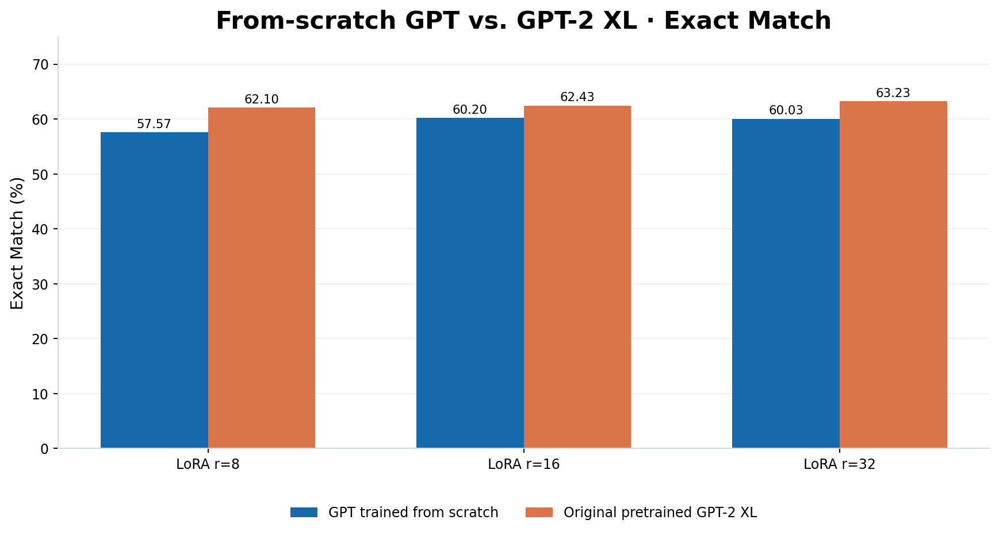
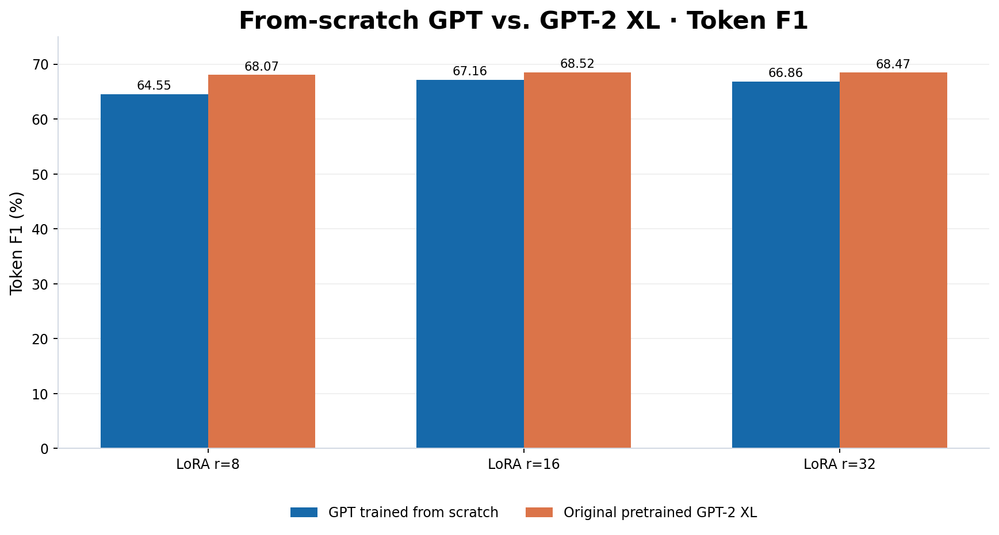
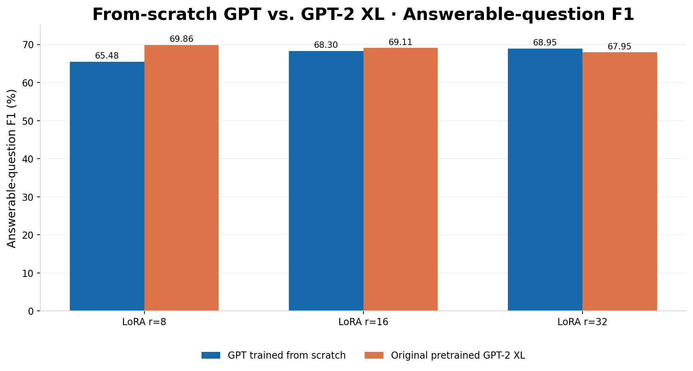
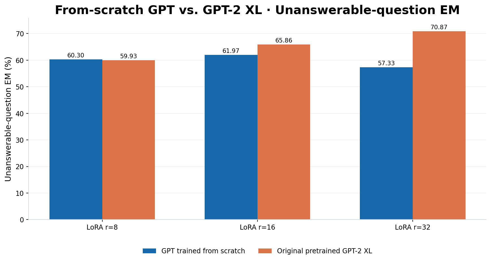
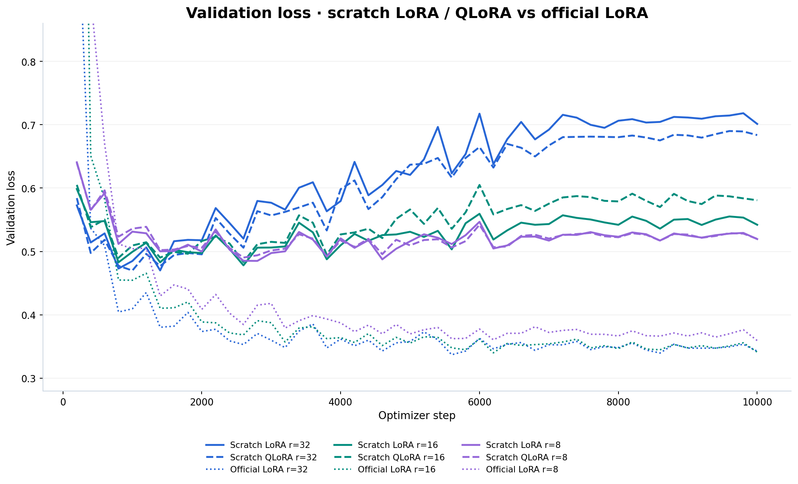

# SQuAD 2.0 Question Answering — Fine-Tuning a GPT Trained from Scratch

**A comparison of LoRA and partial fine-tuning on a GPT pretrained from scratch, followed by a matched-task benchmark against the original pretrained GPT-2 XL.**

This phase of [MJ-LLMForge](https://github.com/mammadjv/MJ-LLMForge) adapts a custom decoder-only GPT pretrained from scratch to SQuAD-style QA and compares it with the public, originally pretrained GPT-2 XL under a closely matched downstream protocol. The implementation includes answer-only supervised learning, block-causal masking for packed examples, multi-GPU training, low-rank attention adapters, adapter merging, and autoregressive evaluation of both answerable and unanswerable questions.

> **Scope of reported results:** These are **project-internal results on 3,000 questions from a custom, shard-based holdout of the SQuAD 2.0 training split**. They are **not official SQuAD 2.0 development or test-set scores**. Five from-scratch GPT checkpoints and three pretrained GPT-2 XL LoRA checkpoints were evaluated on the same 3,000-question subset using corresponding greedy-decoding and EM/F1 scoring procedures.

## Table of Contents

- [Overview and key findings](#overview-and-key-findings)
- [Evaluation results](#evaluation-results)
  - [Aggregate Exact Match and F1](#aggregate-exact-match-and-f1)
  - [Answerable vs. unanswerable questions](#answerable-vs-unanswerable-questions)
  - [What the score differences mean](#what-the-score-differences-mean)
- [GPT-2 XL reference baseline](#gpt-2-xl-reference-baseline)
  - [Limited pretraining budget and model alignment](#limited-pretraining-budget-and-model-alignment)
  - [Matched-rank LoRA evaluation](#matched-rank-lora-evaluation)
  - [Answerability: what is and is not replicated](#answerability-what-is-and-is-not-replicated)
  - [GPT-2 XL training order, loss curves, and checkpoint selection](#gpt-2-xl-training-order-loss-curves-and-checkpoint-selection)
  - [Scope and methodological limitations](#scope-and-methodological-limitations)
- [Model and supervised QA objective](#model-and-supervised-qa-objective)
  - [Prompt representation](#prompt-representation)
  - [Answer-only loss and block-causal masking](#answer-only-loss-and-block-causal-masking)
- [Fine-tuning methods](#fine-tuning-methods)
  - [Partial conventional fine-tuning](#partial-conventional-fine-tuning)
  - [Low-Rank Adaptation (LoRA)](#low-rank-adaptation-lora)
  - [Checkpoints](#checkpoints)
- [Dataset and evaluation protocol](#dataset-and-evaluation-protocol)
  - [Tokenization, sharding, and splits](#tokenization-sharding-and-splits)
  - [Autoregressive evaluation and metrics](#autoregressive-evaluation-and-metrics)
- [Distributed training and loss analysis](#distributed-training-and-loss-analysis)
  - [Training configuration](#training-configuration)
  - [Training-loss curves](#training-loss-curves)
  - [Validation-loss curves](#validation-loss-curves)
  - [Checkpoint selection and overfitting](#checkpoint-selection-and-overfitting)
- [Reproduction](#reproduction)
  - [GPT-2 XL baseline commands](#gpt-2-xl-baseline-commands)

## Overview and key findings

The 3,000-example evaluation contains **2,461 answerable questions (82.03%)** and **539 unanswerable questions (17.97%)**. A correct answer to an unanswerable question is an **empty generated response** (after normalization), represented in the training data by an empty answer field followed by the end-of-text token.

Four observations define the comparison:

1. **LoRA rank 16 has the highest aggregate scores:** **60.20% Exact Match (EM)** and **67.16% token-level F1**. LoRA rank 32 is extremely close at 60.03% EM / 66.86% F1.
2. **Partial fine-tuning with the first 16 layers frozen is strongest on answerable questions:** **62.33% answerable EM** and **71.04% answerable F1**. However, it correctly abstains on only **36.73%** of unanswerable examples.
3. **A strong GPT-2 XL reference baseline is closely approached on this task:** on the same evaluation, the original GPT-2 XL achieves **63.23% EM** at rank 32 and **68.52% F1** at rank 16, versus **60.20% EM / 67.16% F1** for the best from-scratch checkpoint (rank 16).
4. **Answerability drives much of the remaining gap:** the custom rank-32 GPT has **68.95% answerable F1**, exceeding GPT-2 XL rank 32's **67.95%**, while GPT-2 XL leads on unanswerable EM by **13.54 percentage points** at that rank. The custom foundation model was pretrained for only **approximately one-fifth of a single pass through its pretraining dataset**, as reported for this project; that refers to **foundation pretraining**, not to SQuAD LoRA fine-tuning.

These results compare *different adaptation scopes*, not just parameter counts: LoRA modifies attention projections with low-rank updates, whereas partial fine-tuning updates original parameters in selected Transformer blocks. The GPT-2 XL comparison is a **near-reproduction of downstream task behavior**, not a literal replication of architecture, adapter parameterization, pretraining corpus, or pretraining budget.

## Evaluation results

### Aggregate Exact Match and F1


| Fine-tuning method | Overall EM | Overall F1 | Answerable EM | Answerable F1 | Unanswerable EM / F1 |
|:--|--:|--:|--:|--:|--:|
| LoRA · rank 8 | 57.57% | 64.55% | 56.97% | 65.48% | 60.30% |
| **LoRA · rank 16** | **60.20%** | **67.16%** | 59.81% | 68.30% | 61.97% |
| LoRA · rank 32 | 60.03% | 66.86% | 60.63% | 68.95% | 57.33% |
| Partial FT · freeze first 8 | 53.87% | 59.62% | 50.55% | 57.56% | **69.02%** |
| Partial FT · freeze first 16 | 57.73% | 64.87% | **62.33%** | **71.04%** | 36.73% |

**Evaluation population:** 3,000 total questions; all five checkpoints use the same 2,461 answerable / 539 unanswerable split. All percentages above are measured, not estimated from training loss.

The difference between **LoRA rank 16 and rank 32 is only five exact matches out of 3,000** (1,806 versus 1,801). The available data do not establish a robust advantage of rank 16 over rank 32 across new samples or training seeds. Conversely, rank 8 is meaningfully lower on the measured aggregate F1 score, and its lower answerable F1 indicates less effective answer generation in this experiment.

### Answerable vs. unanswerable questions


**Answerable questions (n = 2,461).** These cases reward producing the reference answer, not merely returning a response. Partial FT with the first 16 layers frozen achieves the strongest score (62.33% EM, 71.04% F1). LoRA rank 32 is next on answerable EM (60.63%), followed by rank 16 (59.81%).

**Unanswerable questions (n = 539).** These cases reward correctly producing no answer. Partial FT with the first 8 layers frozen has the highest score (69.02%), while partial FT with the first 16 layers frozen has the lowest (36.73%). LoRA rank 16 sits between them at 61.97%. The weak unanswerable performance of the freeze-16 model offsets its stronger answer extraction.

For an empty ground-truth answer, the metric gives **EM = F1 = 1** if the normalized prediction is empty and **EM = F1 = 0** otherwise. Accordingly, *unanswerable EM and F1 are identical* in the reported evaluation. This is a measure of **correct empty responses**, not a separately calibrated confidence score.

### What the score differences mean

Consider **LoRA rank 16** against **partial FT freezing the first 16 layers**, evaluated on identical questions:

| Group | LoRA r=16 | Partial FT (freeze 16) | Difference for LoRA |
|:--|--:|--:|--:|
| Answerable, exact matches / 2,461 | 1,472 | 1,534 | −62 |
| Unanswerable, correct empty responses / 539 | 334 | 198 | +136 |
| **All examples, exact matches / 3,000** | **1,806** | **1,732** | **+74** |

Thus, the rank-16 LoRA adapter answers **62 fewer answerable questions exactly**, but correctly declines **136 more unanswerable questions**, yielding **74 more correct predictions in total**. Its overall EM advantage is **2.47 percentage points** (60.20% vs. 57.73%).

This is an *answerability trade-off*, not proof that one adaptation method intrinsically understands when to abstain. For example, a checkpoint can look good on unanswerable examples simply by being more inclined to terminate early. To test that possibility, the evaluator would need to measure **false abstention on answerable questions** separately from **wrong nonempty answers**.

The evaluation-set composition also matters. These aggregate scores weight answerable questions about **4.57×** as heavily as unanswerable questions because of their frequencies; a different mixture could change the ranking. The earlier 1,000-example evaluation happened to contain only answerable cases, explaining why its ranking differed from the expanded 3,000-example evaluation.


## GPT-2 XL reference baseline

### Limited pretraining budget and model alignment

The central question is whether the **custom GPT foundation model, trained from scratch**, has learned representations that transfer competitively to SQuAD question answering compared with the public, originally pretrained [`openai-community/gpt2-xl`](https://huggingface.co/openai-community/gpt2-xl). The custom model's **foundation-model pretraining covered approximately one-fifth of a full epoch / one pass over its pretraining corpus**, as reported by the project author. **This ~0.2-epoch statement concerns the earlier language-model pretraining stage, *not* the 10,000-step SQuAD fine-tuning experiments**, and does not describe GPT-2 XL's pretraining budget. The attached QA logs do not independently establish the pretraining token count; thus the fraction is reported rather than calculated from these logs.

Both models use 48 transformer blocks, a width of 1,600, 25 attention heads, GPT-2 BPE tokens, and a 1,024-token maximum sequence length. The custom model's vocabulary is padded to 50,304 tokens, while the original GPT-2 XL vocabulary contains 50,257. Similar macro-architecture and a shared QA protocol make this a useful **downstream representation and adaptation benchmark**, but they do not prove the architectures or their original pretraining procedures are identical.

The GPT-2 XL baseline reuses the project's original packed `qa_dataset.QADataset`, including its train/validation/test shards, per-example block-causal attention masks, and **answer-token-only cross-entropy** (`ignore_index=-1`) on already-shifted targets. Both models use the same **nominal 32,768 tokens per optimizer update** for the LoRA runs and both evaluate the first 3,000 held-out examples through greedy generation to EOT or 150 new tokens. These choices control much of the downstream protocol, although optimizer implementation and low-rank adaptation details still differ.

### Matched-rank LoRA evaluation





| LoRA rank | Model initialization | Overall EM | Overall F1 | Answerable EM | Answerable F1 | Unanswerable EM / F1 |
|:--|:--|--:|--:|--:|--:|--:|
| 8 | GPT trained from scratch | 57.57% | 64.55% | 56.97% | 65.48% | 60.30% |
| 8 | **Original GPT-2 XL** | **62.10%** | **68.07%** | **62.58%** | **69.86%** | 59.93% |
| 16 | GPT trained from scratch | 60.20% | 67.16% | 59.81% | 68.30% | 61.97% |
| 16 | **Original GPT-2 XL** | **62.43%** | **68.52%** | **61.68%** | **69.11%** | **65.86%** |
| 32 | GPT trained from scratch | 60.03% | 66.86% | 60.63% | **68.95%** | 57.33% |
| 32 | **Original GPT-2 XL** | **63.23%** | **68.47%** | **61.56%** | 67.95% | **70.87%** |

**Best-observed overall scores (across the three ranks):** from-scratch GPT **60.20% EM / 67.16% F1** (both rank 16); GPT-2 XL **63.23% EM** (rank 32) and **68.52% F1** (rank 16). The corresponding gaps are **3.03 percentage points in EM** and **1.36 percentage points in F1**. These aggregate comparisons select potentially different ranks; matched-rank rows above are more controlled.

At matched **rank 32**, GPT-2 XL correctly answers **1,897/3,000** examples exactly versus **1,801/3,000** for the from-scratch GPT. The **96-extra-exact-match** difference comes from **23 additional exact matches on answerable questions** (1,515 vs. 1,492 of 2,461) and **73 additional correct empty responses on unanswerable questions** (382 vs. 309 of 539). Approximately **76% of the exact-match advantage comes from unanswerable cases**. Counts are derived from the reported percentages and the fixed subset sizes.

### Answerability: what is and is not replicated





**What is nearly reproduced:** With rank 32, the custom GPT scores **68.95% F1 on answerable questions**, **1.00 percentage point higher** than the originally pretrained GPT-2 XL's **67.95%** under the corresponding rank-32 adapter. The custom GPT does *not* lead on answerable Exact Match (60.63% vs. GPT-2 XL's 61.56%), and at ranks 8 and 16 GPT-2 XL leads on answerable F1. A separate custom *partial fine-tuning* checkpoint (first 16 blocks frozen) reaches **71.04% answerable F1**, but it is not an adaptation-matched comparison against GPT-2 XL LoRA.

**Where replication remains incomplete:** At rank 32, correct abstention on unanswerable questions is **57.33%** for the custom GPT versus **70.87%** for GPT-2 XL—a **13.54-point** gap. This specific distinction is the dominant contributor to their overall EM difference. Rank-16 abstention is closer (**61.97%** vs. **65.86%**), while at rank 8 the custom GPT is marginally higher (**60.30%** vs. **59.93%**). Therefore the statement that the custom model performs better on answerable questions but worse on unanswerable questions **applies most clearly to rank-32 answerable F1 and unanswerable EM**, not uniformly to every rank or metric.

These results show **strong transfer of answer-extraction capability from a model with limited pretraining exposure**, together with a measurable difference in answerability handling. An empty response can reflect the model's tendency to terminate rather than calibrated knowledge of answer absence; future evaluation could add false-abstention and false-answer rates on individual examples to distinguish these behaviors.

### GPT-2 XL training order, loss curves, and checkpoint selection

The full provided GPT-2 XL training log contains **three sequential 10,000-optimizer-step LoRA runs in this order: rank 32, rank 16, rank 8**. Each run logs **501 training-loss samples** (step 1, then every 20 steps) and **50 validation-loss samples** (every 200 steps). These are *QA adaptation* experiments on the pretrained GPT-2 XL, not foundation-model pretraining from scratch.

| Run order | Method | Trainable adapter parameters | Nominal tokens/update | Best validation step | Minimum val loss | Val loss at step 10,000 |
|:--|:--|--:|--:|--:|--:|--:|
| 1 | GPT-2 XL · LoRA r=32 | 9,830,400 (0.627%) | 32,768 | 5,600 | **0.33696** | 0.34261 |
| 2 | GPT-2 XL · LoRA r=16 | 4,915,200 (0.315%) | 32,768 | 6,200 | 0.34004 | 0.34118 |
| 3 | GPT-2 XL · LoRA r=8 | 2,457,600 (0.158%) | 32,768 | 10,000 | 0.35935 | 0.35935 |

The logs confirm a microbatch of **4 packed sequences per GPU**, **2 accumulation microsteps**, **4 GPUs**, and **sequence length 1,024**, giving `4 × 2 × 4 × 1,024 = 32,768` nominal input tokens per optimizer update. The reported trainable-parameter counts are from the GPT-2 XL/PEFT runs; matching rank is **not** equivalent to identical adapter parameter counts in the custom Q/K/V implementation.


The GPT-2 XL validation-loss plot zooms to **step 400 onward** so the later convergence is visible; all step-200 validation values remain in the bundled CSV. All three reference baselines improve markedly during SQuAD adaptation. **Rank 32's validation loss at step 1,400 was 0.38035**, but it continued to improve to **0.33696 at step 5,600**; the initial step-1,400 snapshot was **not** the eventual best checkpoint. The minimum recorded loss for rank 16 is 0.34004 at step 6,200, while rank 8 finishes at its minimum of 0.35935 at step 10,000. Rank 32 has the lowest observed QA validation loss, but **rank 16 has the highest overall test F1**, again showing that validation likelihood and task metrics need not rank checkpoints identically.



The custom GPT's minimum LoRA validation losses were **0.47004 (r=32, step 1,400)**, **0.47809 (r=16, step 2,600)**, and **0.48506 (r=8, step 2,800)**. GPT-2 XL reaches lower teacher-forced validation losses and its best points occur later for all three ranks. Despite this probability-level advantage, the difference in final greedy-decoded EM/F1 is appreciably smaller. **Validation loss is answer-token cross-entropy, not the same quantity as Exact Match or F1.** The two training logs also use different summary conventions: the custom trainer logs average training loss every 200 steps, while the GPT-2 XL trainer reports a per-step training loss every 20 steps. The curves should not be interpreted as identical smoothing or sampling processes.

### Scope and methodological limitations

- **Same downstream task, different pretrained checkpoints:** The GPT-2 XL starting weights came from the public pretrained model; the custom model's original pretraining is author-reported at ~0.2 corpus epoch. The two pretraining data distributions, token exposures, compute, and optimization histories have not been equated. The result is not an estimate of compute efficiency relative to GPT-2 XL's original pretraining.
- **Architecture and LoRA details:** The custom implementation uses separate Q/K/V projection adapters, while GPT-2 XL applies a PEFT adapter to its fused `c_attn` QKV projection. Nominal rank 8/16/32 is matched, but parameter counts, projection structure, and details of normalization/position representations may differ.
- **Distributed training:** The custom fine-tuning experiments used DDP; the GPT-2 XL baseline used FSDP2, with FP16 mixed precision and its own checkpoint-saving path. The baseline's final parameters were restored from each run's **best-validation checkpoint**, not necessarily the last step.
- **Holdout methodology:** The 3,000-question set is an *internal shard-based split of SQuAD 2.0 training data*, uses just one serialized reference answer, and preserves shard order. It is not an official dev/test benchmark, and article/context overlap between shards is possible.
- **Scope of conclusion:** Close answerable F1 for one matched rank is strong evidence that this implementation can reproduce a substantial fraction of GPT-2 XL's **downstream QA behavior after adaptation**. It is not proof of nearly identical base-model language understanding, model internals, or general benchmark performance. A paired per-example error analysis and independent held-out language-model loss/perplexity would strengthen the foundation-model comparison.

## Model and supervised QA objective

The QA system uses a **custom decoder-only Transformer trained from scratch**, rather than a downloaded instruction-tuned language model. Relevant architectural settings are:

| Component | Setting |
|:--|:--|
| Transformer blocks | 48 |
| Attention heads per block | 25 |
| Model/embedding width | 1,600 |
| Maximum context length | 1,024 tokens |
| Tokenization | GPT-2 BPE (`tiktoken`) |
| Padded vocabulary size | 50,304 |
| Output | Autoregressive answer text, terminated by the end-of-text token |

### Prompt representation

Each training example is serialized as:

```text
Context: <passage>
Question: <question>
Answer: <reference answer><|endoftext|>
```

Unanswerable SQuAD 2.0 questions are retained during preprocessing. If `answers['text']` is empty, the serializer emits an empty answer field:

```text
Context: <passage>
Question: <question with no supported answer>
Answer: <|endoftext|>
```

In the actual preprocessing code the answer begins after `"Answer: "`, so an empty answer may include a leading space token. The scoring code removes the end-of-text token and normalizes whitespace, ensuring that this is treated as an empty reference.

### Answer-only loss and block-causal masking

The supervised objective trains the model to **predict answer tokens**, including the terminating end-of-text token. Context and question tokens provide conditioning information but are ignored by the supervised cross-entropy loss:

In words, the QA training loss is the **average negative log-likelihood over only the answer and end-of-text target positions**.

- Let `A` be the set of supervised answer/EOT target positions.
- For each target position `t` in `A`, the model predicts token `x_t` conditioned on all previous visible tokens `x_<t`.
- The loss is the average of `-log p_theta(x_t | x_<t)` over all positions in `A`.
- All positions outside `A` are ignored with `ignore_index = -1`.


Because individual QA examples are packed together in fixed-length token windows, the dataloader also constructs a **block-causal attention mask**. A query can attend only to earlier positions **within the same `Context:` block**. This prevents one packed QA example from reading tokens from an unrelated example in the same training sequence. The implementation excludes incomplete terminal blocks from the supervised mask.

This differs from the usual unmodified causal mask: **autoregressive order is preserved, but cross-example attention is disallowed** during packed training.

## Fine-tuning methods

### Partial conventional fine-tuning

With `lora_rank = 0`, the original pretrained weights are updated in the unfrozen part of the network. The `n_frozen_layers` argument freezes the **first N Transformer blocks**, not the last N. This follows the trainer's implementation, which applies `requires_grad = False` to `transformer.layers[:n_frozen_layers]`.

| Training configuration | Frozen Transformer blocks | Trainable Transformer blocks |
|:--|:--|:--|
| `--lora_rank 0 --n_frozen_layers 8 --iter_batch_size 1` | First 8 | Remaining 40 |
| `--lora_rank 0 --n_frozen_layers 16 --iter_batch_size 1` | First 16 | Remaining 32 |

Parameters outside these blocks may remain trainable depending on their `requires_grad` settings. This is a partial-weight-update comparison against LoRA, not a parameter-matched experiment. In contrast to LoRA's Q/K/V-only updates, these configurations can update the unfrozen Transformer blocks' full attention and feed-forward weights.

### Low-Rank Adaptation (LoRA)

With `lora_rank > 0`, the pretrained matrices remain frozen and learnable low-rank factors are attached to the **query (Q), key (K), and value (V)** attention projections. Tested ranks: **8, 16, 32**.

For a pretrained projection `W`, the adapted projection is:

`W_adapted = W + sBA`

where `A` and `B` are trainable low-rank factors, `rank(BA) <= r`, and `s` denotes the implementation's adapter scaling.

At inference, the project's `apply_lora()` operation **merges** the learned `BA` updates into the pretrained Q/K/V weights, so the model can generate without recomputing an adapter branch at each token.

This is a comparison of **LoRA on Q/K/V throughout the network** versus **direct weight updates in unfrozen Transformer blocks**. It is *not* an equal-parameter comparison, and the code/logs supplied do not establish exact parameter counts or peak VRAM for each configuration.

### Checkpoints

| Checkpoint | Adaptation |
|:--|:--|
| `lora_weights_8.pt` | LoRA Q/K/V, rank 8 |
| `lora_weights_16.pt` | LoRA Q/K/V, rank 16 |
| `lora_weights_32.pt` | LoRA Q/K/V, rank 32 |
| `best_model_nxl9_frozen_8.pt` | Partial FT, first 8 blocks frozen (40 unfrozen) |
| `best_model_nxl9_frozen_16.pt` | Partial FT, first 16 blocks frozen (32 unfrozen) |

## Dataset and evaluation protocol

### Tokenization, sharding, and splits

The preprocessing script uses Hugging Face Datasets to load:

```python
load_dataset("squad_v2", split="train")
```

It concatenates each context, question, reference answer, and `<|endoftext|>` marker, tokenizes using GPT-2 BPE, and writes consecutive shards of approximately **1,000,000 tokens** as `uint16` arrays. The dataset uses the following shard-level split:

| Split in this project | Selection |
|:--|:--|
| Validation | `all_shards[:1]` |
| Evaluation (`test`) | `all_shards[1:3]` |
| Training | `all_shards[3:]` |

The iterable test dataset reconstructs examples by finding `Context:` and `Answer:` boundaries and yielding a prompt plus the target answer. It does **not** remove empty-answer questions. The first 3,000 examples produced by the iterator were scored for this report, **in the original shard order**.

**Important:** This is a holdout of serialized *training-split tokens*, not the official SQuAD 2.0 held-out development set. Shard boundaries are based on token count, not document identity, so different shards can still share article or context material. The tokenizer also stores **only the first annotated valid answer**, not every reference accepted in official SQuAD scoring.

### Autoregressive evaluation and metrics

For each checkpoint, evaluation runs on one GPU with the same procedure:

1. Instantiate the same GPT architecture, load the partial-FT checkpoint or load pretrained base weights plus a LoRA adapter, then merge adapters if applicable.
2. Feed the prompt ending in `Answer:`; do **not** include ground truth in the input.
3. Decode greedily (`argmax`) until `<|endoftext|>` or the configured token limit (150 new tokens by default). Generation uses a sliding context bounded by 1,024 tokens.
4. Remove EOT from both prediction and reference; normalize by lowercasing, removing punctuation and `a/an/the`, then collapsing whitespace.
5. Calculate normalized **Exact Match (EM)** and word/token-overlap **F1**, both in aggregate and separately for answerable and unanswerable examples.

For nonempty references, F1 is the harmonic mean of unigram-token precision and recall. If either normalized prediction or reference is empty, F1 is **1 only if both are empty**; otherwise it is **0**.

All checkpoints were evaluated on the same **3,000 examples**; the evaluation output reports **0 prompts initially longer than the context window**.

## Distributed training and loss analysis

### Training configuration

Training was performed using **PyTorch Distributed Data Parallel (DDP) across four GPUs** with one model replica per rank. Gradient accumulation approximates a larger global batch while limiting per-device memory use. Gradients are synchronized on the final accumulation micro-step, rather than at every micro-step.

For fixed-length packed sequences, the nominal token count per optimizer update is:

`N_tokens_per_update = seq_len × local_batch_size × GPU_count × accumulation_steps`

This counts packed input positions, **not necessarily the number of supervised answer tokens** remaining after masking.

The supplied training log records **five 10,000-step experiments** in the exact execution order below. All curves contain **50 logged train/validation summaries**, sampled every **200 optimizer steps**. Training uses mixed-precision gradient scaling, a learning rate reaching approximately **5 × 10⁻⁵** around step 101, and cosine-style decay afterward. The log environment reports **PyTorch 2.8.0 with CUDA 12.6**.

| Experiment (in supplied log order) | Command-line overrides | Trainable Transformer blocks |
|:--|:--|:--|
| **LoRA r=32** | `--lora_rank 32 --n_frozen_layers 0` | Adapter weights only (Q/K/V across blocks) |
| **LoRA r=16** | `--lora_rank 16 --n_frozen_layers 0` | Adapter weights only (Q/K/V across blocks) |
| **LoRA r=8** | `--lora_rank 8 --n_frozen_layers 0` | Adapter weights only (Q/K/V across blocks) |
| **Partial FT · freeze first 8** | `--lora_rank 0 --n_frozen_layers 8 --iter_batch_size 1` | Last 40 blocks |
| **Partial FT · freeze first 16** | `--lora_rank 0 --n_frozen_layers 16 --iter_batch_size 1` | Last 32 blocks |

All plotted points are taken directly from the logged `avg train loss` and `avg val loss` summaries; curves are not smoothed or interpolated. The 50 validation summaries per configuration are periodic measurements of the validation objective, not the final 3,000-question autoregressive EM/F1 evaluation.

### Training-loss curves


The three LoRA configurations have visibly different training-loss trajectories. At step 10,000, **LoRA r=32** ends at **0.0594**, **LoRA r=16** at **0.1656**, and **LoRA r=8** at **0.2716**. The higher-capacity LoRA ranks fit the supervised training targets more closely, but their final training losses do not predict the evaluation ranking: **r=16**, not r=32, has the best aggregate held-out EM/F1.

Both partial fine-tuning configurations approach near-zero training loss: **0.00058** when the **first 8 blocks are frozen** and **0.00093** when the **first 16 blocks are frozen**. With 40 or 32 Transformer blocks left trainable, their greater weight-update capacity can fit the training targets very closely. Neither near-zero value should be interpreted as evidence of excellent generalization.

A logarithmic y-axis makes all five curves readable on a shared figure without hiding the extremely small final losses of the partial FT configurations.

### Validation-loss curves


Each dot marks that configuration's **lowest logged validation loss**. The minimum is measured at the reporting cadence of 200 steps, so a lower loss may have occurred between reports.

| Configuration | Best logged validation step | Minimum val loss | Train loss at step 10,000 | Val loss at step 10,000 |
|:--|--:|--:|--:|--:|
| LoRA r=32 | 1,400 | 0.4700 | 0.0594 | 0.7012 |
| LoRA r=16 | 2,600 | 0.4781 | 0.1656 | 0.5421 |
| LoRA r=8 | 2,800 | 0.4851 | 0.2716 | 0.5195 |
| Partial FT · freeze first 8 | 400 | 0.5379 | 0.00058 | 1.2223 |
| Partial FT · freeze first 16 | 800 | **0.4693** | 0.00093 | 1.0998 |

The larger adaptation scope of partial fine-tuning corresponds to much faster fitting of the supervised answers, followed by substantially worse late-validation performance. The LoRA experiments maintain comparatively lower terminal validation losses, with **r=8** finishing at 0.5195 despite its higher training loss. **LoRA r=16** and **r=8** reach their logged validation minima later (steps 2,600–2,800) than the partial FT configurations (steps 400–800).

### Checkpoint selection and overfitting

The partial fine-tuning trajectories provide the clearest examples of **overfitting**:

- **Freeze first 8 / train remaining 40:** validation loss rises from **0.5379 at step 400** to **1.2223 at step 10,000**, even though training loss falls to **0.00058**.
- **Freeze first 16 / train remaining 32:** validation loss rises from **0.4693 at step 800** to **1.0998 at step 10,000**, with training loss just **0.00093**.

The latter run attains the **lowest single recorded validation loss** among the five experiments but loses much of that advantage by the end. Consequently, **best-validation checkpoint selection** is essential: selecting a last-step model would be especially misleading for these partial fine-tuning configurations.

LoRA r=32 also shows validation degradation after its minimum (0.4700 → 0.7012), though less dramatically than the two partial fine-tuning runs. LoRA r=8 and r=16 have smaller late-training validation gaps. These patterns are consistent with differences in adaptation capacity, but training configurations also differ in their batch-size overrides, so they are not a strictly controlled one-variable comparison.

**Connecting losses to QA behavior:** The best validation loss does not necessarily yield the best **EM/F1 or abstention behavior**. The three metrics measure different objectives: teacher-forced answer-token likelihood, autoregressive exact extraction, and ability to stop when an answer is unsupported. In the 3,000-example evaluation, LoRA r=16 leads aggregate EM/F1 even though partial FT with 16 frozen blocks records a slightly lower best validation loss. The comparison motivates reporting both training dynamics and final task behavior.

One log also reports an NCCL/CUDA out-of-memory warning during **process-group cleanup after final metrics were printed**; the 10,000-step summary remains present. The error belongs in raw training records but does not remove the logged loss data.

## Reproduction

**Training (4 GPUs):** The runs above use the following argument combinations, listed in execution order: `--lora_rank 32 --n_frozen_layers 0`, `--lora_rank 16 --n_frozen_layers 0`, `--lora_rank 8 --n_frozen_layers 0`, `--lora_rank 0 --n_frozen_layers 8 --iter_batch_size 1`, and `--lora_rank 0 --n_frozen_layers 16 --iter_batch_size 1`.

```bash
torchrun --standalone --nproc_per_node=4 \
  train_eval_squad.py --phase train --config config.json
```

**Evaluation (1 GPU):**

```bash
torchrun --standalone --nproc_per_node=1 \
  <evaluation-script>.py --config config.json
```

Replace `<evaluation-script>.py` with the standalone evaluation script used in this repository. It reads checkpoints from its configured checkpoint list and writes `qa_inference_results.json`. The reported comparison used `test_limit = 3000`; setting `test_limit` to `null` instead evaluates the available custom test iterator in full. The generation limit defaults to `test_max_new_tokens = 150` unless overridden.

The test code checks the expected model/adaptor keys, loads pretrained GPT weights before LoRA weights, and calls `apply_lora()` before inference. For partial-FT models it loads the fine-tuned model state directly.

### GPT-2 XL baseline commands

Run all three reference-baseline experiments using the **same `config.json`, packed dataset, and 4-GPU launch** (your local copy of the packed GPT-2 XL trainer may be named `train_eval_squad_gpt2xl.py`):

```bash
# Run in this order: r=32, then r=16, then r=8
for r in 32 16 8; do
  torchrun --standalone --nproc_per_node=4 \
    train_eval_squad_gpt2xl.py --phase train --config config.json \
    --lora_rank "$r" --n_frozen_layers 0
done
```

Evaluate each best-validation checkpoint on exactly the same 3,000 examples (one GPU):

```bash
for r in 32 16 8; do
  torchrun --standalone --nproc_per_node=1 \
    train_eval_squad_gpt2xl.py --phase test --config config.json \
    --lora_rank "$r" --test_limit 3000 \
    --checkpoint "gpt2xl_qa/lora_rank${r}_best.pt"
done
```

The evaluation JSON outputs are written as `gpt2xl_qa/lora_rank{r}_qa_inference_results.json`. In Slurm, use the same launch/environment configuration as the project's existing distributed job rather than assuming `--standalone` handles multi-node placement. The **three GPT-2 XL training curves** in this README are reproduced from the supplied log; the `data/` files in the downloadable README bundle preserve the underlying loss and evaluation series for future graph updates.

To embed all plots in a GitHub README, retain **all chart PNGs** in the repository's `assets/` directory alongside this file; Markdown image references use **relative paths**.
